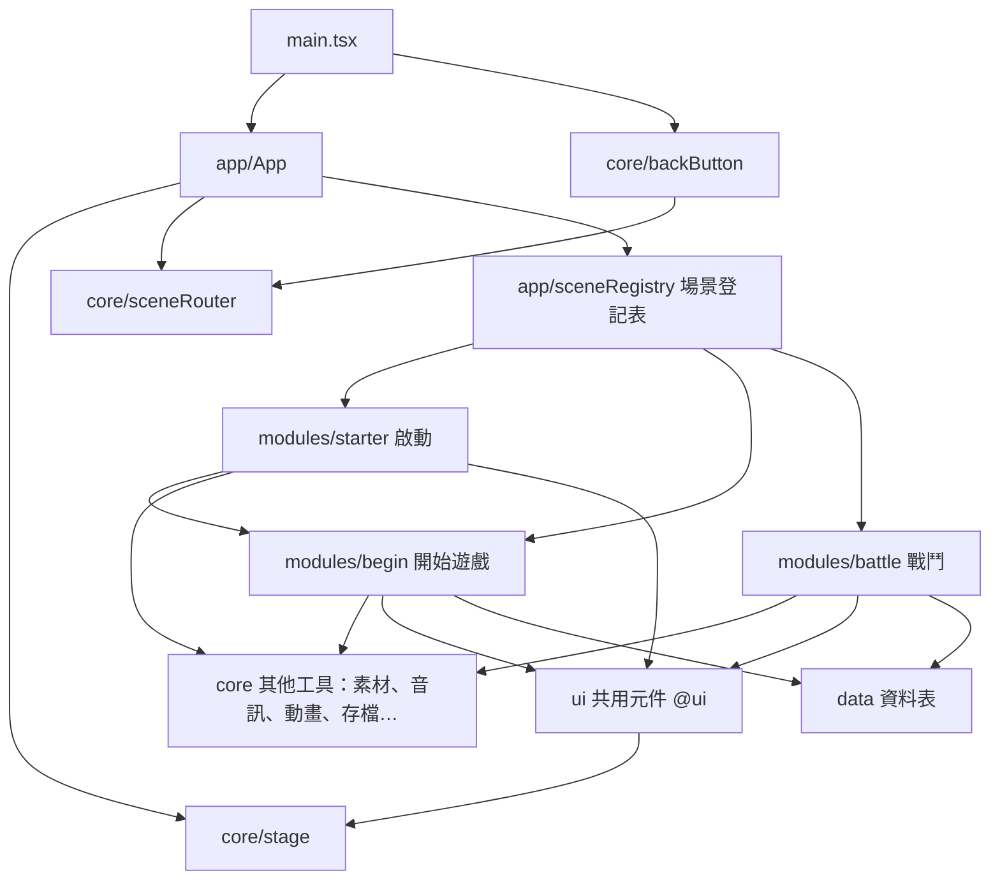
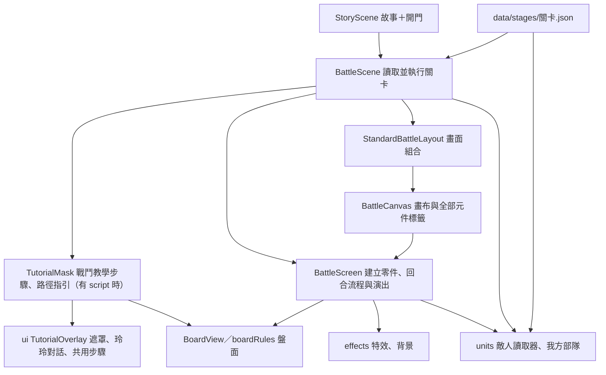
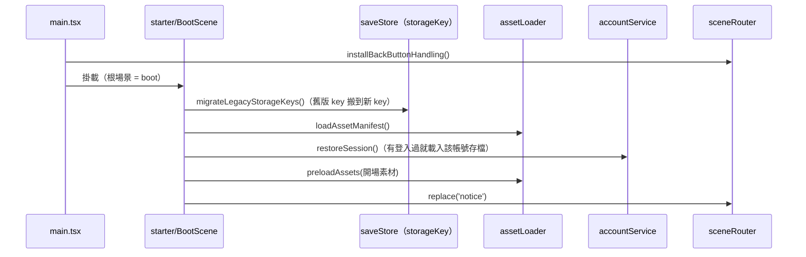

# 模組與相依關係

## 1. 相依圖

遊戲功能分成三大類（`modules/`），依玩家經過的順序：**starter**（啟動，每次開遊戲）→ **begin**（開始遊戲，每個帳號一次）→ **battle**（戰鬥）。
箭頭表示「使用」。`core` 不依賴任何遊戲模組；三大類之間只有一個例外：`starter` → `begin`（讀取中恢復帳號、檢查語音包；標題畫面判斷下一步），而且只用 `begin/index.ts` 的公開 API。`begin` 與 `battle` 互不 import，共用的初始武將資料放在 `data/generals/`。

### 1.1 戰鬥內部

## 2. 各模組

| 模組         | 檔案                                                                             | 提供                                                                                                                                                                                                | 依賴                                  |
| ------------ | -------------------------------------------------------------------------------- | --------------------------------------------------------------------------------------------------------------------------------------------------------------------------------------------------- | ------------------------------------- |
| 舞台         | `core/stage.ts`                                                                  | `mountStage`、`designUnit()`、`translateUnits()`：640 設計單位換算；`currentStage`、`onStageResize`；安全黑邊 `SAFE_MARGINS`                                                                        | —                                     |
| 場景路由     | `core/sceneRouter.ts`                                                            | `sceneRouter.setRoot/push/replace/back`、`setBackHandler`、`useSceneStack`                                                                                                                          | —                                     |
| 返回鍵       | `core/backButton.ts`                                                             | `installBackButtonHandling`：攔截瀏覽器返回、Android 返回鍵、Esc → `sceneRouter.back()`；`leaveGame()` 離開遊戲                                                                                     | 場景路由、Capacitor App               |
| 素材         | `core/assetLoader.ts`                                                            | `loadAssetManifest`、`getAsset(id)`、`getAssetUrl`、`getAssetSize`、`preloadAssets(ids)`                                                                                                            | `public/assets/manifest.json`         |
| 音訊         | `core/audioService.ts`                                                           | `audioService.playBackgroundMusic`、`playSoundEffect`、`playVoice`、`unlock`；同一時間只有一個 AudioService（開發時熱更新會關掉舊的，背景音樂不會疊加）                                             | 存檔（音量）                          |
| 存檔         | `core/saveStore.ts`                                                              | `saveStore.load/update/exportJson/importJson`、版本遷移 `saveMigrations`、儲存 key `storageKey(name)`、`migrateLegacyStorageKeys()`（舊前綴 threeKingdomsPuzzleWars、sanpazu → 新前綴 3PZ）         | —                                     |
| 動畫         | `core/animate.ts`                                                                | `wait`、`nextFrame`、`playKeyframes`（毫秒）                                                                                                                                                        | —                                     |
| 觸覺回饋     | `core/haptics.ts`                                                                | `haptics.pulse(毫秒)`、`haptics.enabled`：Android 瀏覽器短震動，iOS 網頁略過                                                                                                                        | —                                     |
| UI 元件      | `ui/components.tsx`、`atlas.tsx`、`bitmapText.tsx`（一律 `import … from '@ui'`） | `Sprite`、`NineSliceFrame`、`TextLabel`、`SpriteButton`、`uiAsset()`；`AtlasPartSprite`、`AtlasAnimation`、`atlasPartStyle`；`BitmapText`、`renderBitmapText`                                       | 素材、舞台                            |
| 教學遮罩     | `ui/TutorialOverlay.ts`                                                          | `TutorialOverlay`（`show`：擋下操作、變暗、高亮、只留可操作範圍；`say`；`tap`）、`runTutorialSteps`（JSON 步驟 say／tap／wait／save／goto＋畫面自訂步驟）                                           | 素材、存檔、場景路由                  |
| 資料表       | `data/`                                                                          | `stages/*.json`（關卡，含敵人資料 units）、`starterGenerals.json`（初始武將）、`pieces.json`（小兵圖集、走路禎序、姿勢）、`atlas/`、`font/`                                                         | —                                     |
| 啟動         | `modules/starter/`                                                               | `BootScene`（讀取中：素材清單、恢復帳號、預載）、`NoticeScene`、`TitleScene`、`ConnectingDialog`                                                                                                    | 素材、動畫、音訊、begin（帳號、語音） |
| 帳號         | `modules/begin/logic/accountService.ts`                                          | `accountService.register/login/playAsGuest/logout/restoreSession`；`AccountProvider` 介面、本機帳號提供者                                                                                           | 存檔                                  |
| 語音包       | `modules/begin/logic/voicePackService.ts`、`components/VoicePackScene.tsx`       | `voicePackService.refresh/download/cancelDownload/remove`；`VoicePackScene` 詢問畫面                                                                                                                | 音訊                                  |
| 開始遊戲畫面 | `modules/begin/`                                                                 | `components/`：`AccountScene`、`PlayerNameScene`、`VoicePackScene`、`StarterSelectScene`（含立繪補丁 `createPatchedImage`）、`FormWindow`                                                           | UI、存檔、帳號、初始武將資料          |
| 戰鬥場景     | `modules/battle/components/BattleScene.tsx`                                      | 場景 id `battle`（參數 `{ stage }`）：讀取關卡（`logic/stageData.ts`），一般戰鬥依各合戰的勝利條件過關；有 `tutorial` 時交給 `runTutorialScript`                                                    | 下列各檔、存檔、音訊                  |
| 戰鬥畫面組合 | `modules/battle/components/StandardBattleLayout.tsx`、`BattleCanvas.tsx`         | 元件標籤：`Scenery`、`Enemies`、`Board`、`Effects`、`Troops`、`PartyPortraits`、`PartyHpBar`、`ChestCounter`、`RelationChart`、`MenuButton`、`WaveBanner`、`TutorialMask`；`useHud()`、`useParty()` | 戰鬥畫面                              |
| 戰鬥畫面     | `modules/battle/logic/BattleScreen.ts`                                           | 依標籤建立零件、一回合流程與各階段演出；`playTurn`、`playEnemyTurn`、`playWaveBanner`、`playFadeFromWhite`、`playVictory`、`setBoardGridVisible`、`setChestCount`、`elementOf(id)`                  | 下列各檔                              |
| 敵人與我方   | `modules/battle/logic/units.ts`                                                  | `createWaveEnemies`（合戰的敵人 → 站位、星數 → 大小；前後排見 `formation.ts`）、`createParty`、`EnemyLayer`（點敵人鎖定／解除目標 `toggleTarget`）、`PartyPanel`                                    | 素材、點陣字                          |
| 特效與背景   | `modules/battle/logic/effects.ts`                                                | 魂、命中、大字、轉場、衝鋒小兵圖；`BattleBackground`                                                                                                                                                | 素材                                  |
| 盤面         | `modules/battle/logic/boardRules.ts`、`BoardView.ts`                             | 規則：路徑移動、找組、往上補位、盤面記法、錄影補位佇列（純函式，有測試）；`BoardView`（拖曳 `startDrag/moveDrag/endDrag/cancelDrag`、消除、補位、連擊字、開場滑入）；小兵圖                         | 素材、點陣字                          |
| 關卡開場     | `modules/battle/components/StoryScene.tsx`                                       | 故事畫面＋開門                                                                                                                                                                                      | 素材、音訊                            |
| 新手教學     | `modules/battle/components/TutorialMask.tsx`                                     | `<TutorialMask>`、`TutorialMaskController`（`overlay`、`guideMove`：只亮路徑的格子、只允許照路徑轉珠，沒走完放開就退回起點重來）；`runTutorialScript`：關卡 JSON 的 `script`＝共用步驟＋戰鬥步驟    | 戰鬥畫面、盤面                        |

## 3. 主要流程

### 3.1 啟動

### 3.2 開場（復刻 亞修實況 0～61 秒）

starter：`boot`（讀取中）→ `notice` →（2 秒或點擊）→ `title` →（點擊）
→ begin：未登入 `account` ／ 未取名 `name` → 未詢問語音 `voice` → `starter`（選擇初始武將）
→ battle：`story`（故事＋開門）→ `battle`（`stage: tutorial1`）→ `tutorialReward`（下一步）

場景 id `starter` 是「選擇初始武將」畫面（屬於 begin），和模組名稱 `starter`（啟動）不同，網址 `#scene=` 會用到所以保留不改。

### 3.3 返回

任何返回來源 → `sceneRouter.back()` → 目前場景若有 `onBack` 且回傳 `false` 則由場景自行處理（例：關閉對話框）→ 否則 pop 子場景 → 已在根場景時呼叫 `onExitRequest`：App 顯示「確定要離開遊戲嗎？」，再按一次返回＝取消；按「離開」時原生 App 關閉，網頁版回到進入遊戲前的頁面（沒有上一頁時提示自行關閉分頁）。

### 3.4 語音

建置時 `_開發工具_不需修改/素材轉檔/build-assets.mjs` 產生 `voice/voice-index.json` → 使用者在詢問畫面或系統設置按「下載」→ 逐檔存入 Cache Storage → `audioService.playVoice(id)` 從快取播放；未下載則略過。

### 3.5 一回合戰鬥（`BattleScreen.playTurn`）

`BoardView.resolveMatches()`（消除 → 魂 → 數字 → 補位 → 連鎖）→ `BattleScreen.ts` 下半的 `playComboMultiplier`（連擊倍率）→ `playLeaderSkill`（軍略）→ `playPartyAttack`（小兵衝向敵人、命中、死亡）→ 回復 HP。敵人回合：`playEnemyTurn`。

## 4. 新增功能的方式

1. 先決定屬於 starter／begin／battle 哪一類，在該類底下建資料夾（戰鬥的新部分放進五個部分之一，新關卡放 `battle/stages/<關卡>/`）；畫面元件與邏輯分開（邏輯不碰 DOM，方便測試）。功能由多個子部分組成時，每個子部分一個子資料夾，並以 `index.ts` 匯出公開 API。
2. 在 `app/sceneRegistry.ts` 登記場景 id。
3. 需要的存檔欄位加在 `SaveData`，並在 `SAVE_VERSION` 升版時於 `core/saveStore.ts` 的 `saveMigrations` 補遷移函式。
4. 依 [`命名規範.md`](命名規範.md) 命名。
5. 更新本文件的相依表與流程圖。
