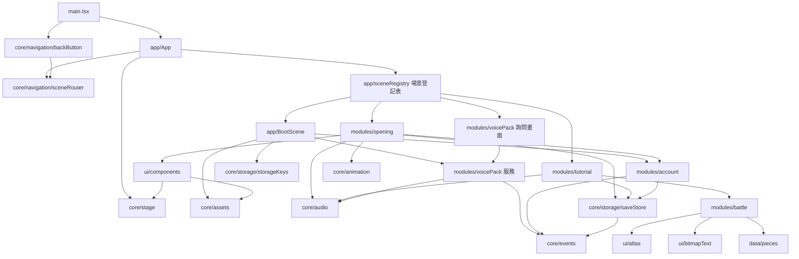
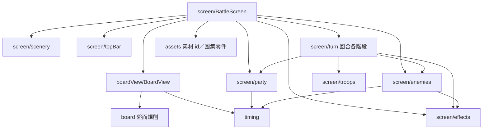
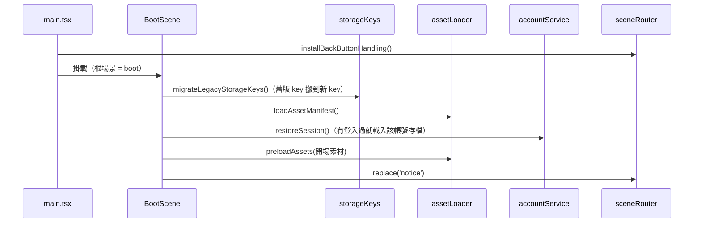

# 模組與相依關係

## 1. 相依圖

箭頭表示「使用」。`core` 不依賴任何遊戲模組；遊戲模組原則上不互相 import，例外（流程組合，只用對方 `index.ts` 的公開 API）：
`opening` → `account`；`tutorial` → `battle`；`app/BootScene` → `account`、`voicePack`。

### 1.1 戰鬥模組內部

## 2. 各模組

| 模組 | 檔案 | 提供 | 依賴 |
|---|---|---|---|
| 舞台 | `core/stage/stage.ts` | `mountStage`、`designUnit()`、`translateUnits()`：640 設計單位換算；`currentStage`、`onStageResize` | — |
| 場景路由 | `core/navigation/sceneRouter.ts` | `sceneRouter.setRoot/push/replace/back`、`setBackHandler`、`useSceneStack` | — |
| 返回鍵 | `core/navigation/backButton.ts` | `installBackButtonHandling`：攔截瀏覽器返回、Android 返回鍵、Esc → `sceneRouter.back()` | 場景路由、Capacitor App |
| 拖曳捲動 | `core/input/DragScroll.tsx` | `<DragScroll>`：拖曳、慣性、回彈；拖動後不觸發點擊 | — |
| 素材 | `core/assets/assetLoader.ts` | `loadAssetManifest`、`getAsset(id)`、`getAssetUrl`、`getAssetSize`、`preloadAssets(ids)` | `public/assets/manifest.json` |
| 圖片補丁 | `core/assets/imagePatch.ts` | `createPatchedImage`：以原圖自身像素覆蓋一塊 | 素材 |
| 音訊 | `core/audio/audioService.ts` | `audioService.playBackgroundMusic`、`playSoundEffect`、`playVoice`、`unlock` | 存檔（音量） |
| 存檔 | `core/storage/saveStore.ts`、`saveMigrations.ts` | `saveStore.load/update/exportJson/importJson`，版本遷移 | 事件、儲存 key |
| 儲存 key | `core/storage/storageKeys.ts` | `storageKey(name)`、`migrateLegacyStorageKeys()`（舊前綴 threeKingdomsPuzzleWars、sanpazu → 新前綴 3PZ） | — |
| 動畫 | `core/animation/animate.ts` | `wait`、`nextFrame`、`playKeyframes`、`fadeIn/fadeOut`（毫秒） | — |
| 事件 | `core/events/eventBus.ts` | `eventBus.on/emit`，事件型別集中在 `GameEvents` | — |
| UI 元件 | `ui/components/` | `Sprite`、`NineSliceFrame`、`TextLabel`、`SpriteButton`、`uiAsset()` 素材 id 捷徑 | 素材、舞台 |
| 圖集零件 | `ui/atlas/`、`data/pieces/pieceAtlas.ts` | `AtlasPartSprite`、`AtlasAnimation`（依毫秒輪播零件）、`atlasPartStyle`；小兵走路禎序 | 素材、舞台 |
| 點陣字 | `ui/bitmapText/` | `renderBitmapText`、`<BitmapText>`：原版字型圖＋切字座標，執行時上色 | 素材 |
| 帳號 | `modules/account/` | `accountService.register/login/logout/restoreSession`；`AccountProvider` 介面、`providers/localAccountProvider.ts` | 存檔、事件 |
| 語音包 | `modules/voicePack/` | `voicePackService.refresh/download/cancelDownload/remove`；`VoicePackScene` 詢問畫面 | 音訊、事件 |
| 開場 | `modules/opening/` | 注意、標題、連線中、帳號、輸入名字 | UI、動畫、音訊、帳號、存檔 |
| 盤面規則 | `modules/battle/board/` | 路徑移動、找組、往上補位、盤面記法、錄影佇列、可重現亂數（純函式，有測試） | — |
| 盤面畫面 | `modules/battle/boardView/` | `BoardView`（拖曳、消除、補位、連擊字）、`paintPieceSprite` | 盤面規則、素材、點陣字 |
| 戰鬥畫面 | `modules/battle/screen/` | `BattleScreen`（背景、敵人、部隊、HP、攻擊、合戰字、勝利）；子部分見 §1.1 | 盤面畫面、素材、點陣字 |
| 教學 | `modules/tutorial/` | 選擇武將、舒適版、故事、教學戰鬥 1 腳本、玲玲對話、路徑指引 | 戰鬥、存檔、音訊 |

## 3. 主要流程

### 3.1 啟動

### 3.2 開場（復刻 亞修實況 0～61 秒）

`notice` →（3692 ms）→ `title` →（點擊）→ 連線中 → 未登入：`account` ／ 未取名：`name` → 未詢問語音：`voice` → `starter`（選擇武將）→ `comfort` → `story` → `tutorialBattle` → `tutorialReward`（下一步）

### 3.3 返回

任何返回來源 → `sceneRouter.back()` → 目前場景若有 `onBack` 且回傳 `false` 則由場景自行處理（例：開場各畫面直接忽略）→ 否則 pop 子場景 → 已在根場景時呼叫 `onExitRequest`（網頁版不動作）。

### 3.4 語音

建置時 `tools/assets/build-assets.mjs` 產生 `voice/voice-index.json` → 使用者在詢問畫面或系統設置按「下載」→ 逐檔存入 Cache Storage → `audioService.playVoice(id)` 從快取播放；未下載則略過。

### 3.5 一回合戰鬥（`BattleScreen.playTurn`）

`boardView.resolveMatches()`（消除 → 魂 → 數字 → 補位 → 連鎖）→ `turn/comboMultiplierPhase`（連擊倍率）→ `turn/leaderSkillPhase`（軍略）→ `turn/partyAttackPhase`（小兵衝向敵人、命中、死亡）→ 回復 HP。敵人回合：`turn/enemyAttackPhase`。

## 4. 新增功能的方式

1. 在 `modules/<功能>/` 建資料夾；畫面元件與邏輯分開（邏輯不碰 DOM，方便測試）。功能由多個子部分組成時，每個子部分一個子資料夾，並以 `index.ts` 匯出公開 API。
2. 在 `app/sceneRegistry.ts` 登記場景 id。
3. 需要的存檔欄位加在 `SaveData`，並在 `SAVE_VERSION` 升版時於 `saveMigrations.ts` 補遷移函式。
4. 依 [`命名規範.md`](命名規範.md) 命名。
5. 更新本文件的相依表與流程圖。
